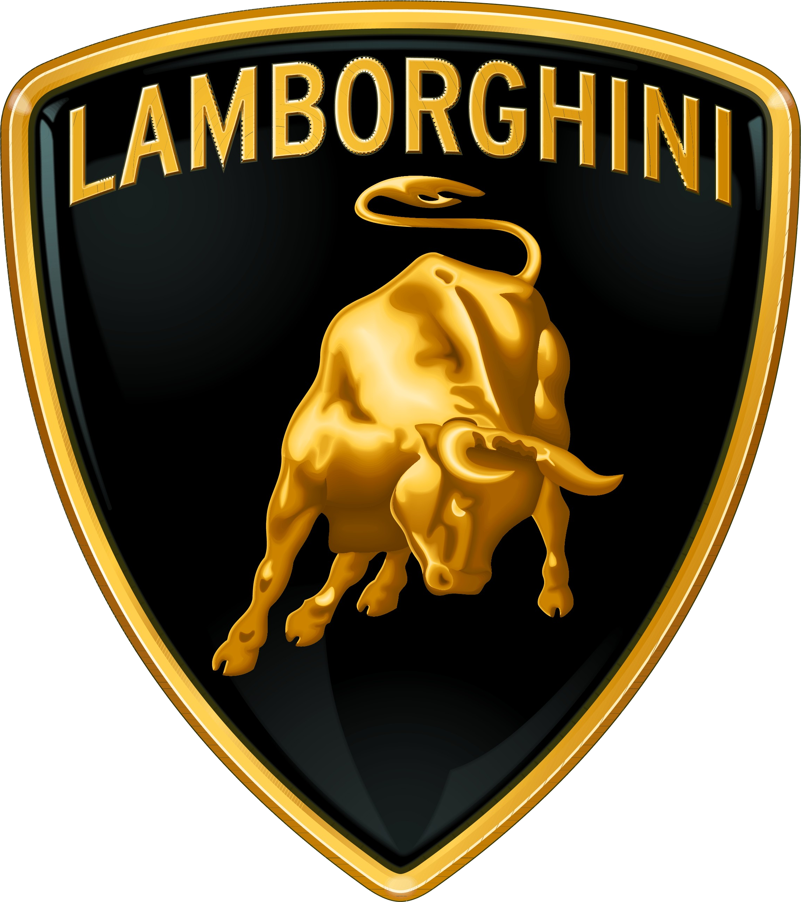
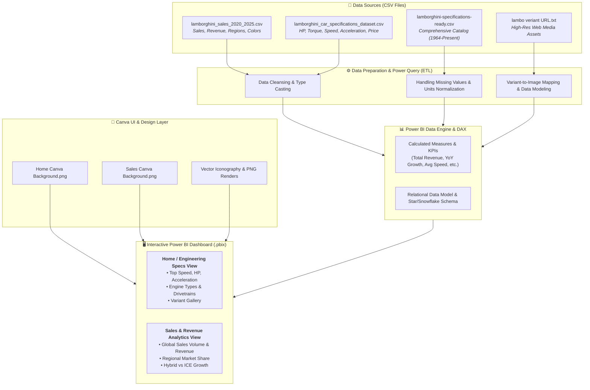
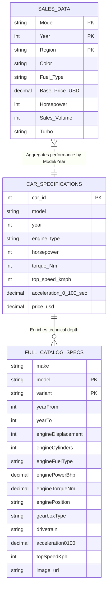
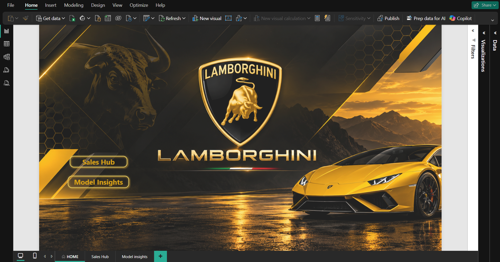

<div align="center">
  

  # 🏎️ Lamborghini Revenue & Performance Analytics Dashboard
  ### ⚡ Next-Generation Commercial Intelligence & Supercar Engineering Benchmarks

  [](https://powerbi.microsoft.com/)
  [](https://learn.microsoft.com/en-us/dax/)
  [](https://www.canva.com/)
  [](https://powerbi.microsoft.com/)
  []()
</div>

An end-to-end **Business Intelligence & Supercar Analytics Dashboard** built in **Microsoft Power BI** paired with bespoke **Canva UI/UX layouts**. This project delivers in-depth commercial sales performance tracking (2020–2025) and deep technical specification benchmarking across Lamborghini’s entire historic and modern hypercar lineup (from the legendary 1964 350 GT to the groundbreaking 2025 Revuelto Hybrid & Urus SE).

---

## 📑 Table of Contents

- [Executive Summary](#-executive-summary)
- [Interactive Dashboard Video Walkthrough](#-interactive-dashboard-video-walkthrough)
- [Dashboard Showcase & Visual Experience](#-dashboard-showcase--visual-experience)
- [Key Features](#-key-features)
- [Project Architecture & Data Flow](#-project-architecture--data-flow)
- [Data Model & Entity Relationships](#-data-model--entity-relationships)
- [Repository Structure](#-repository-structure)
- [Dataset Dictionary](#-dataset-dictionary)
- [Key DAX Measures & Formulas](#-key-dax-measures--formulas)
- [Getting Started & Installation](#-getting-started--installation)
- [Key Analytical Insights](#-key-analytical-insights)
- [Author & Credits](#-author--credits)

---

## 🚀 Executive Summary

The **Lamborghini Rev Analytics** project bridges the gap between raw automotive engineering data and executive-level business analytics. Designed with a custom luxury dark-mode theme, the report provides:

1. **Commercial Sales & Revenue Intelligence (2020–2025)**: Evaluates unit volumes, revenue generation, regional distribution (Americas, EMEA, APAC), color preferences, and the massive transition towards hybrid powertrains (V12 HPEV & PHEV).
2. **Automotive Engineering & Performance Benchmark**: Examines mechanical specifications across 90+ model variants, comparing 0–100 km/h acceleration, top speed, brake horsepower (BHP), torque (Nm), weight-to-power ratios, and engine configurations (V8, V10, V12, Hybrid).

---

## ✨ Key Features

- 🎨 **Bespoke Glassmorphism & Luxury Canvas Design**: Tailor-made Canva background templates designed specifically for visual hierarchy, contrast, and KPI framing.
- 📊 **Dynamic KPI Metric Cards**: Visual cards featuring custom iconography (`accelerate`, `engine`, `price-tag`, `sales`, `speedometer`).
- 🌍 **Multi-Region & Powertrain Slicing**: Instant cross-filtering by Year (2020–2025), Market Region (Americas, EMEA, APAC), Model Line (Urus, Huracán, Aventador, Revuelto), and Fuel Type.
- 🏎️ **Variant Showcase with Image URLs**: Integrated dynamic media linking to high-resolution imagery for each model variant.
- ⚡ **Hybrid Transition Tracking**: Visualized shift from pure combustion engines to high-performance hybrids (Revuelto & Urus SE).

---

## 🏗️ Project Architecture & Data Flow



---

## 🗄️ Data Model & Entity Relationships



---

## 🎬 Interactive Dashboard Video Walkthrough

Experience the dynamic Lamborghini Power BI dashboard in action with fluid slicers, interactive tooltips, cross-filtering, and seamless page transitions:

<div align="center">
  <video src="assets/Dashboard Video.mp4" width="100%" controls="controls">
    Your browser does not support the video tag. <a href="assets/Dashboard Video.mp4"><b>Click here to view or download the Dashboard Walkthrough Video directly.</b></a>
  </video>
</div>

<p align="center">
  <sub><i>🎥 <b>Interactive Video Demo</b>: Demonstrating real-time KPI card responses, multi-select slicers (Year, Region, Fuel Type), and dual-view navigation.</i></sub>
</p>

### ⏱️ Video Highlights & Feature Timeline

| Time Marker | Report View | Demonstrated Capabilities & Interactions |
| :---: | :--- | :--- |
| **0:00 – 0:15** | 🏎️ **Home / Specification Overview** | Dynamic KPI metric cards (Top Speed, Horsepower, 0–100 sprint times), automated CDN variant rendering upon trim selection. |
| **0:15 – 0:30** | 🎛️ **Multi-Dimensional Slicing** | Real-time cross-filtering across Model lines (Urus, Huracán, Revuelto, Aventador), Sales Regions (Americas, EMEA, APAC), and Powertrain (ICE vs. Hybrid). |
| **0:30 – 0:45** | 📊 **Sales & Revenue Analytics Hub** | Commercial metrics tracking ($ Volume, ASP, Grossing leaders), regional market share distributions, and hybridization growth. |
| **0:45 – 1:00** | ⚙️ **Model Insights & Technical Matrix** | Side-by-side performance benchmarking and engineering attribute breakdown across 90+ classic and modern models. |

---

## 🖼️ Dashboard Showcase & Visual Experience

### 1. Home / Specification & Performance Overview
> **Core Focus**: High-level automotive engineering specs, peak performance benchmarks, and dynamic variant gallery.

<div align="center">
  
</div>

- **Visual Canvas**: Custom luxury dark-mode layout built on `Home Canva Background.png`.
- **Key Visual Components**:
  - ⚡ **Performance KPI Gauges**: Real-time cards for Max Horsepower, Peak Top Speed (km/h), Best 0–100 km/h sprint times, and Average Torque (Nm).
  - 🏎️ **Dynamic Trim Selector & Gallery**: Live variant image rendering connected to high-resolution CDN assets.
  - 📊 **Mechanical Matrix Table**: Granular breakdown of engine displacement (cc), cylinder configurations, transmission types, and drivetrain systems (AWD vs. RWD).

---

### 2. Commercial Sales & Revenue Hub
> **Core Focus**: 2020–2025 Global commercial performance, revenue trajectories, regional market share, and hybridization adoption.

<div align="center">
  
</div>

- **Visual Canvas**: Tailor-made executive canvas designed with `Sales Canva Background.png`.
- **Key Visual Components**:
  - 💵 **Financial Summary Cards**: Total Revenue ($), Total Deliveries, Average Selling Price (ASP), and Top Grossing Supercar Line.
  - 🌍 **Geographical Sales Distribution**: Territory revenue share across **Americas**, **EMEA**, and **APAC**.
  - 📈 **Yearly Commercial Trajectory (2020–2025)**: Tracking historical volume surges fueled by the Urus Super SUV and Revuelto rollout.
  - 🔋 **Powertrain Transition Mix**: Visualizing the market transition from pure ICE to high-performance hybrids (HPEV / PHEV).

---

### 3. Model Insights & Technical Benchmarking
> **Core Focus**: Comprehensive model-by-model technical benchmarking, engine architecture comparisons, and historical timeline analytics.

<div align="center">
  
</div>

- **Visual Canvas**: Unified luxury aesthetic engineered for high data density and readability.
- **Key Visual Components**:
  - 🏁 **Cross-Model Performance Benchmarking**: Side-by-side spec comparison across 90+ model variants from 1964 to present.
  - ⏱️ **Sprint & Top Speed Curves**: Direct correlation between engine displacement, horsepower, and track acceleration.
  - 🎯 **Multi-Dimensional Slicing**: Instant cross-filtering by model family (Aventador, Huracán, Urus, Revuelto, Countach, Diablo, Miura).

---

## 📁 Repository Structure

```plaintext
9 Project (Power Bi Extra)/
├── 📄 README.md                                # Comprehensive Project Documentation
├── 📊 Lamborghini_Rev_Analytics.pbix           # Main Power BI Report & Data Model
├── 🖼️ Home Canva Background.png                # Custom UI Canvas for Home/Specs Page
├── 🖼️ Sales Canva Background.png               # Custom UI Canvas for Sales Analytics Page
│
├── 📂 assets/                                  # High-Resolution Media & Walkthrough Video
│   ├── 🎥 Dashboard Video.mp4                  # Full HD Interactive Dashboard Walkthrough Video
│   ├── 🛡️ lamborghini_logo.png                 # Official Lamborghini Shield Crest Logo
│   ├── 🖼️ Home.png                             # Report Page 1: Home & Specification Overview
│   ├── 🖼️ Sales Hub.png                        # Report Page 2: Commercial Sales & Revenue Hub
│   └── 🖼️ Model Insights.png                   # Report Page 3: Model Insights & Performance Analytics
│
├── 📂 Lamborgini Dataset/                       # Source Data Warehouse (CSV files)
│   ├── 📄 lamborghini_sales_2020_2025.csv      # Sales volume, base pricing, regions (2020-2025)
│   ├── 📄 lamborghini_car_specifications_dataset.csv # Specs dataset (HP, Speed, Torque, Accel)
│   └── 📄 lamborghini-specifications-ready.csv # Master catalog (1964-Present, 34 attributes)
│
└── 📂 Icons and Image URL/                     # UI Icons, Vector Graphics & CDN Links
    ├── 📄 lambo veriant URL.txt                # Curated list of high-definition variant image URLs
    ├── 🖼️ accelerate.png                       # 0-100 Acceleration KPI icon
    ├── 🖼️ engine.png / engine-removebg.png     # Powertrain & Displacement KPI icon
    ├── 🖼️ speedometer.png                      # Top Speed KPI icon
    ├── 🖼️ sales.png                            # Units & Volume KPI icon
    ├── 🖼️ price-tag.png                        # Valuation & ASP KPI icon
    ├── 🖼️ lamborghini_PNG10709.png             # Transparent vehicle render
    └── 🖼️ pngwing.com (*).png                  # Supplementary transparent vehicle graphics
```

---

## 📋 Dataset Dictionary

### 1. `lamborghini_sales_2020_2025.csv`
| Column Name | Data Type | Description | Example |
| :--- | :--- | :--- | :--- |
| `Model` | Text | Name of the vehicle model | Urus, Huracán, Revuelto |
| `Year` | Integer | Sales calendar year | 2020 – 2025 |
| `Region` | Text | Sales territory | EMEA, Americas, APAC |
| `Color` | Text | Exterior body paint color | Giallo Inti, Nero Noctis, Verde Mantis |
| `Fuel Type` | Text | Powertrain classification | Gasoline, Hybrid |
| `Base Price (USD)` | Decimal | Manufacturer Base MSRP | $230,000 – $580,000 |
| `Horsepower` | Integer | Rated engine horsepower | 631 – 1,001 HP |
| `Sales Volume` | Integer | Annual units delivered | 63 – 6,200 units |
| `Turbo (Yes/No)` | Text | Forced induction presence | Yes / No |

### 2. `lamborghini-specifications-ready.csv` (Catalog Extract)
| Attribute | Description |
| :--- | :--- |
| `engineDisplacement` | Engine capacity in cubic centimeters (cc) |
| `enginePowerBhp` / `enginePowerKw` | Power output in Brake Horsepower & Kilowatts |
| `engineTorqueNm` | Maximum torque rating in Newton-meters |
| `acceleration0100` | 0 to 100 km/h acceleration time (seconds) |
| `topSpeedKph` / `topSpeedMph` | Top speed capacity |
| `gearboxType` & `gears` | Transmission system (Manual, Automatic, Semi-Automatic, AMT) |
| `drivetrain` | All-Wheel Drive (AWD) vs Rear-Wheel Drive (RWD) |
| `dimensions` | Length, Width, Height, Wheelbase (mm), Weight (kg) |

---

## 📐 Key DAX Measures & Formulas

Below are sample DAX measures implemented in the data model:

### 1. Total Revenue
```dax
Total Revenue = 
SUMX(
    'lamborghini_sales_2020_2025',
    'lamborghini_sales_2020_2025'[Sales Volume] * 'lamborghini_sales_2020_2025'[Base Price (USD)]
)
```

### 2. Total Units Sold
```dax
Total Units Sold = 
SUM('lamborghini_sales_2020_2025'[Sales Volume])
```

### 3. Average Selling Price (ASP)
```dax
Average Selling Price = 
DIVIDE([Total Revenue], [Total Units Sold], 0)
```

### 4. Year-over-Year (YoY) Sales Growth %
```dax
YoY Sales Growth % = 
VAR CurrentYearSales = [Total Units Sold]
VAR PrevYearSales = 
    CALCULATE(
        [Total Units Sold],
        SAMEPERIODLASTYEAR('Calendar'[Date])
    )
RETURN
    DIVIDE(CurrentYearSales - PrevYearSales, PrevYearSales, 0)
```

---

## ⚡ Getting Started & Installation

### Prerequisites
- **Microsoft Power BI Desktop** (Latest Version recommended - [Download Here](https://powerbi.microsoft.com/desktop/))
- Operating System: Windows 10/11

### Step-by-Step Execution
1. **Clone or Download the Repository**:
   ```bash
   git clone https://github.com/your-username/lamborghini-rev-analytics.git
   ```
2. **Open the Report**:
   - Double-click `Lamborghini_Rev_Analytics.pbix` to launch the dashboard in Microsoft Power BI Desktop.
3. **Data Source Verification (Optional)**:
   - If prompted to refresh data sources, navigate to:  
     `Home` ➡️ `Transform Data` ➡️ `Data Source Settings` and ensure the path points to the `Lamborgini Dataset/` folder.
4. **Interact & Explore**:
   - Use the slicers to filter by year, region, or vehicle line.
   - Switch between the **Overview/Specs** tab and the **Sales Analytics** tab.

---

## 🔍 Key Analytical Insights

1. **The Urus Dominance**: The Urus Super SUV consistently drives over 55–60% of total unit delivery volumes, underscoring the luxury performance SUV segment's profitability.
2. **The Hybrid Revolution**: With the debut of the **Revuelto** (1,001 HP V12 Hybrid) in 2024 and **Urus SE** in 2024–2025, hybrid variants rapidly represent the primary revenue growth driver.
3. **Regional Distribution**: The **Americas** region remains the largest market by volume, closely followed by **EMEA**, with **APAC** exhibiting the highest percentage growth in ASP.
4. **Engineering Evolution**: Analysis reveals a 275% power output increase from the 1964 350 GT (267 BHP) to the 2024+ Revuelto (1,001 BHP), accompanied by a decrease in 0–100 km/h acceleration from 6.5s to under 2.5s.

---

## 👨‍💻 Author & Credits

- **Project Lead & BI Developer**: Data Analytics Portfolio
- **Design & Layout**: Custom crafted with Canva & Figma
- **Data Credits**: Automotive Technical Databases & Lamborghini Sales Registries

---
*Disclaimer: All trademarks, logos, and brand names are the property of their respective owners (Automobili Lamborghini S.p.A.). This project is created strictly for educational and portfolio demonstration purposes.*
